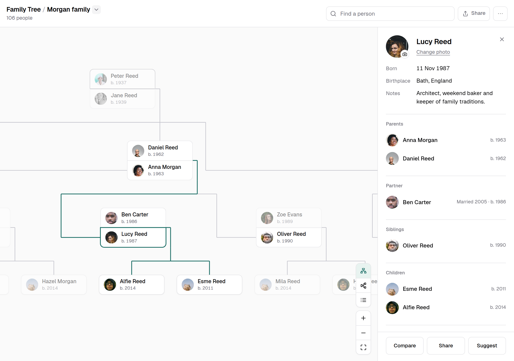

# Family Tree

Self-hosted, private family trees with graph/list views, photos, search, relationship comparison, sharing and GEDCOM import/export. Public code; private family data.



*Fictional demo · [Photo credits](docs/images/CREDITS.md).*

## Host your own

One application, two deployments. Follow [setup & recovery](docs/operations.md).

| | [Docker](docs/operations.md#docker) | [Cloudflare](docs/operations.md#cloudflare) |
|---|---|---|
| Runtime | Node.js + SQLite + private files | Workers + D1 + private R2 |
| Configuration | `.env.example` → `.env` | `web/installation.example.json` → `web/installation.json` |
| Cost | Your hardware/hosting | Free within Cloudflare usage limits |

Visitors enter a shared family password. Approved editors and the configured owner sign in with Google. Access covers every tree in the installation; share links never bypass it.

| Role | Permissions |
|---|---|
| Viewer | Browse, suggest changes, add/replace photos |
| Editor | Also edit people/relationships, review suggestions, clear photos |
| Owner | Also manage trees/access/settings, import, delete people, export backups |

## Optional MCP

Requires Python 3.10+ and [uv](https://docs.astral.sh/uv/). Create a token under **Agent access**, then configure your MCP client to run `uv run family-tree-mcp` with:

| Environment | Value |
|---|---|
| `FAMILY_TREE_URL` | App URL including base path, e.g. `https://family.example.com/family-tree` |
| `FAMILY_TREE_TOKEN` | Owner-issued token, stored in client secrets |

Works with either host; edits save directly. Search before adding people and reuse their IDs across trees.

## Develop

Node.js 26.12.1+, pnpm 12.15.0; Docker for production-image tests.

```sh
pnpm --dir web install --frozen-lockfile
pnpm --dir web build
pnpm --dir web dev
```

Open **http://localhost:8000/family-tree/**; password: `local-preview-only`. The preview starts empty and stores data separately; screenshot demo data is not included.

Editing requires [Google sign-in setup](docs/operations.md#google-and-first-sign-in): `GOOGLE_CLIENT_ID`, `OWNER_EMAIL` and an authorized localhost origin.

[Checks & code map](AGENTS.md) · [Operations](docs/operations.md) · [Architecture](docs/private-hosting/adr-002-two-deployments-one-application.md) · [MIT](LICENSE) · [ELK.js](web/ui/vendor/README.md) · [Geist (OFL)](https://github.com/vercel/geist-font/blob/main/LICENSE)
